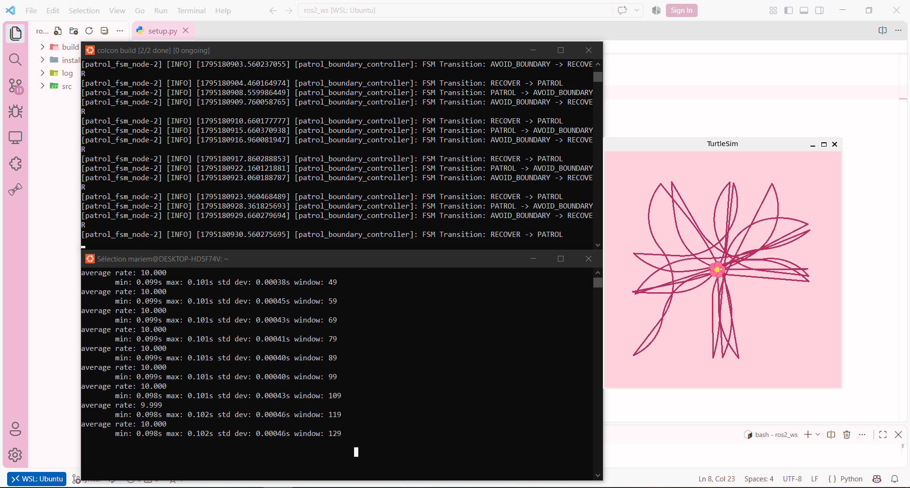
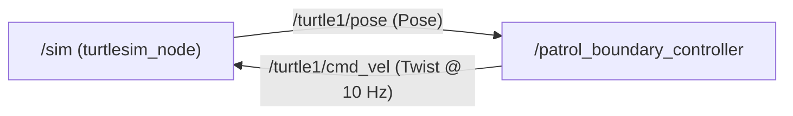

# Autonomous Robot Patrol & Boundary Avoidance Controller (ROS 2)

A **ROS 2 (Humble / `rclpy`)** navigation node that uses a **Finite State Machine (FSM)** to patrol an area autonomously while keeping the robot safely inside virtual boundaries at a steady **10 Hz** loop.



## What This Project Does

When a mobile robot patrols an area without a map, it needs clear rules so it doesn't crash into walls or get stuck in corners. This project implements a closed-loop ROS 2 node (`patrol_fsm_node`) that reads the robot's live position (`/turtle1/pose`), checks if it is getting too close to the edges, and sends linear and angular speed commands (`/turtle1/cmd_vel`) every **100 ms (10 Hz)**.

## How It Works (Architecture)

The simulator and the controller node talk to each other over ROS 2 topics:



### Project Files

| File / Folder | What It Does |
| :--- | :--- |
| `patrol_boundary_controller/patrol_fsm_node.py` | Main Python ROS 2 node with the 3-state FSM and 10 Hz timer |
| `launch/patrol.launch.py` | Launch file that starts TurtleSim, sets the background/pen colors, and runs the controller |
| `docs/demo.png` | Screenshot showing live FSM state logs, `10.000 Hz` publish rate, and the patrol path |
| `package.xml` & `setup.py` | ROS 2 package configuration and executable setup |

## Finite State Machine (FSM) Logic

The robot switches between three simple states so it turns cleanly and never gets stuck jittering on a wall:

| State | What the Robot Does | When It Switches |
| :--- | :--- | :--- |
| **`PATROL`** | Moves forward at `linear_speed` and adds small random turns every 2 seconds to cover different parts of the arena. | Robot reaches the boundary (`x` or `y` $\le 1.5$ or $\ge 9.5$). |
| **`AVOID_BOUNDARY`** | Stops moving forward (`0.0 m/s`), calculates the angle back toward the center `(5.54, 5.54)` using `atan2`, and turns in place. | Robot is facing the center (angle error $\le 0.15\text{ rad}$). |
| **`RECOVER`** | Drives straight forward for 8 ticks (`0.8 s`) to get safely back inside the arena before patrolling again. | The 8-tick recovery countdown finishes. |

## Configurable Parameters

You can adjust the boundaries and speeds without changing the code using ROS 2 parameters:

| Parameter | Default | Description |
| :--- | :---: | :--- |
| `min_bound` | `1.5` | Minimum X and Y limit before turning back (meters) |
| `max_bound` | `9.5` | Maximum X and Y limit before turning back (meters) |
| `linear_speed` | `1.8` | Forward driving speed (m/s) |
| `angular_speed` | `2.2` | Turning speed when avoiding a wall (rad/s) |

## How to Run It

### 1. Build the package
```bash
cd ~/ros2_ws
colcon build --packages-select patrol_boundary_controller
source install/setup.bash
```

### 2. Launch everything together
```bash
ros2 launch patrol_boundary_controller patrol.launch.py
```

### 3. Check the loop rate & active node
```bash
ros2 topic hz /turtle1/cmd_vel
ros2 node info /patrol_boundary_controller
```

## Moving From Simulation to Real Hardware

Because this node only depends on standard `/pose` inputs and `/cmd_vel` (`geometry_msgs/Twist`) outputs, the exact same navigation logic can run on a real differential-drive robot by forwarding `/cmd_vel` to an **ESP32** or **STM32** motor controller over **micro-ROS** or UART.
